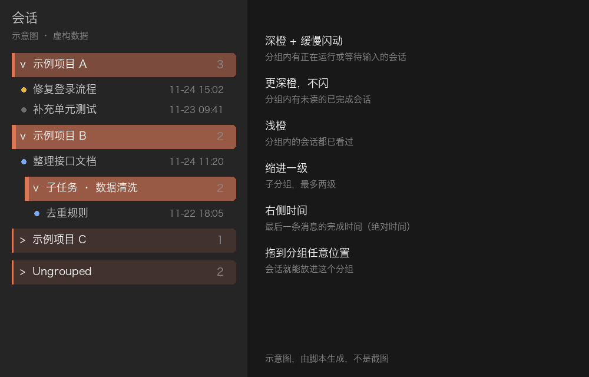

# Claude Code VS Code 侧边栏补丁

给 VS Code 里的 Claude Code 插件（`anthropic.claude-code`）侧边栏加几项本地改动：会话分组的颜色区分、分组拖拽排序、两级分组、按会话独立的模型选择、上下文满了提示开新线程。



> 上图是脚本生成的示意图，使用虚构的会话名，不是截图。

## 功能

| 功能 | 说明 |
| --- | --- |
| 分组颜色 | 分组行用橙色底和左侧色条，与会话原色区分开 |
| 运行状态 | 分组里有正在运行或等待输入的会话时，分组行深橙并缓慢闪动 |
| 未读提示 | 有未读的已完成会话时，分组更深、色条更粗，不闪 |
| 分组排序 | 拖动分组标题改变顺序，组内会话跟着走 |
| 两级分组 | 把分组拖到另一个分组中间，或右键选择「放入」，只到两级 |
| 会话拖入分组 | 会话可以拖到分组任意位置，不限分组标题 |
| 隐藏归档 | Archived sessions 区块整块隐藏，归档名单和对话文件都保留 |
| 组内排序 | 分组内的会话按最后一条消息的完成时间排列，最新的在最上面 |
| 绝对时间 | 会话行右侧显示最后一条消息的完成时间，今年显示 `MM-DD HH:mm`，跨年显示 `YYYY-MM-DD HH:mm` |
| 按会话的模型 | 切换模型只影响当前会话，不影响其他正在运行的会话；重开后记得住 |
| 上下文提示 | 不自动压缩。上下文过半时提示开新线程，点击发送 `/handoff` |

## 环境

- macOS（自动运行部分使用 LaunchAgent）
- VS Code，已安装 `anthropic.claude-code`
- Python 3（系统自带即可，只用标准库）
- Node.js（脚本用 `node --check` 校验改完的 JS）

## 安装

```bash
git clone https://github.com/<your-account>/claude-code-vscode-sidebar-patch.git
cd claude-code-vscode-sidebar-patch

# 1. 打补丁
python3 reapply.py

# 2. 可选：安装自动重打（登录时 + 插件更新时运行）
./install-launchagent.sh
```

然后在 VS Code 里执行 `Developer: Reload Window`。

如果需要 `/handoff` 命令，把 `optional/handoff.md` 复制到 `~/.claude/commands/`。

## 工作原理

Marketplace 发布的插件是压缩过的 JavaScript，每次更新都会整体替换。补丁不依赖固定的变量名，而是用正则在代码结构里找位置：

- 找不到位置时停止，并输出 `BLOCKED: <原因>`，不会硬改。
- 每次写入前备份为 `*.bak-before-group-patch`。
- 写完用 `node --check` 检查语法，不通过就恢复原文件。
- 重复运行是安全的，已经打过的部分会跳过。

插件更新后，补丁会被覆盖。`install-launchagent.sh` 安装的 LaunchAgent 会在 `extensions.json` 变化时重新运行脚本。日志在 `~/Library/Logs/claude-code-sidebar-patch.log`。

## 撤销

每个被修改的文件旁边都有 `.bak-before-group-patch` 备份。把备份复制回原文件名即可恢复，然后 Reload Window。也可以直接更新或重装插件，插件目录会被替换为官方版本。

## 限制

- 只在 macOS 上测试过。
- 依赖插件的内部代码结构。插件大版本改动较大时，脚本可能停止（`BLOCKED`），需要按报错调整正则。
- 按会话的模型记忆保存在 VS Code 的 globalState 中，只在本机有效。

## 免责声明

本项目是非官方的第三方脚本，与 Anthropic 无关，不由 Anthropic 维护或背书。脚本会修改本机已安装的插件文件，请自行判断风险，并遵守 Anthropic 的服务条款和插件许可。使用前请先备份。本项目按现状提供，不附带任何保证。

## 目录

```
reapply.py                 主脚本：打补丁
install-launchagent.sh     安装自动重打的 LaunchAgent
optional/handoff.md        可选的 /handoff 命令文件
docs/HANDOVER.md           交接说明：需求、结构、逐项改动
assets/sidebar-preview.png 效果示意图（虚构数据）
```
